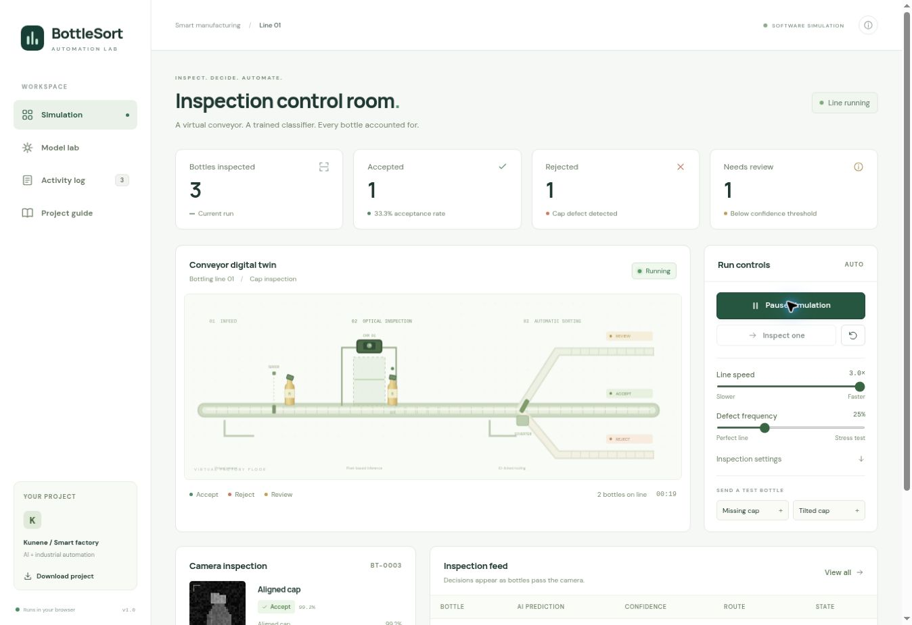

# BottleSort Lab

A complete browser-based AI and industrial automation simulation for Kunene.

**[Open the live simulation](https://bottle-sort-lab-kunene.bakedpivot2.chatgpt.site)** — sign in with ChatGPT if prompted.



## Run the application

```bash
python -m http.server 8000 --directory dist
```

Open http://localhost:8000 in a modern browser. Serve the files over HTTP; opening index.html directly as a file will block JavaScript modules and model loading in some browsers. No API key, hardware, Node dependencies, or backend is required to run the application. Google Fonts is optional; system fonts are used if it cannot load.

1. Start the conveyor, or use **Inspect one** for one automatic cycle.
2. Send a **Missing cap** or **Tilted cap** test bottle.
3. Open **Inspection settings** to vary confidence and lighting disturbance.
4. Review the model's probabilities and the bottle's route.
5. Open **Activity log** to filter, reopen inspections, and export a CSV.

The latest 2,000 inspections and control settings are saved in local browser storage. Reloading interrupts in-flight bottles; the log explicitly marks these as Interrupted. Reset clears this browser's simulated run and preserves settings. This is a synthetic demonstration, not an inspection system validated for real products.

## Reproduce the model

Python dependencies: numpy, scikit-learn. The exact versions used are recorded in `project/environment.json`.

```bash
pip install numpy scikit-learn
python project/train_model.py
```

Or open `dist/train_model.ipynb` in Google Colab and run all cells. The training code creates new `dist/model.json` and `project/evaluation.json` files. Copy a newly trained model into the application's `dist` directory and reload to use it.

## Verify cross-language inference

```bash
node project/test_engine.mjs
```

The tests compare the Python and JavaScript image generators and probabilities, reconstruct all 420 test predictions, and verify confidence routing. Read `dist/PROJECT_REPORT.md` for methodology, architecture, limitations, and experiments.

## Files

| Path | Purpose |
| --- | --- |
| dist/index.html | Interface and accessible controls |
| dist/style.css | Responsive presentation |
| dist/app.js | Conveyor state machine, dashboard, logs, and CSV export |
| dist/engine.js | Deterministic pixel generator and softmax inference |
| dist/model.json | Learned weights and evaluation summary |
| dist/train_model.ipynb | Executed, reproducible training notebook |
| project/train_model.py | Training and dataset generation |
| project/evaluation.json | Full synthetic test metrics |
| project/test_engine.mjs | Cross-language and routing verification |
| project/renderer_fixtures.json | Independent Python renderer fixtures |
| dist/PROJECT_REPORT.md | Project report and learning activities |

## Architecture

Synthetic condition → camera pixels → learned classifier → confidence rule → per-bottle route → virtual diverter → inspection log.

The synthetic condition is used only to generate images and evaluate predictions. The classifier receives the pixel array, not the ground-truth class. Sorting decisions are latched to individual bottle IDs at inspection.

## Publish on Hugging Face

The deployment targets **Oageng/BottleSort-AI** as a **Static** Space. The existing HTML interface, learned model, simulation, and downloads run entirely in the browser.

### One-time Space setup

Create a public Space under **Oageng** with:

| Field | Value |
| --- | --- |
| Space name | `BottleSort-AI` |
| Short description | AI bottle inspection and automated sorting simulation |
| SDK | Static |
| Template | Blank |

In that Space's **Settings → Trusted Publishers**, add:

| Field | Value |
| --- | --- |
| Provider | GitHub Actions |
| Repository | `OagengKunene/BottleSort-AI` |
| Branch | `main` |
| Workflow | `deploy-huggingface.yml` |
| Read-only | Unchecked |

The publisher gives this workflow temporary write access to this Space only. No Hugging Face account password or long-lived token needs to be stored in GitHub.

### Deploy and update

Push application changes in `dist/` to `main`, or open GitHub **Actions → Deploy BottleSort-AI to Hugging Face → Run workflow**. If the first run happened before the one-time Space setup, rerun its failed job after setup.

The workflow first runs `npm test` against the model, Python-generated fixtures, all 420 held-out images, and routing rules. It then prepares a separate upload directory and publishes the contents of `dist/` plus the Hugging Face Space card. Relative paths to the model, scripts, styles, notebook, report, and project ZIP are preserved.

To inspect the package locally, choose a separate empty directory outside this repository:

```bash
python project/prepare_huggingface.py --output /tmp/bottlesort-ai-space
python -m http.server 8000 --directory /tmp/bottlesort-ai-space
```

See [Hugging Face's Trusted Publishers documentation](https://huggingface.co/docs/hub/en/trusted-publishers) for the authentication mechanism.
